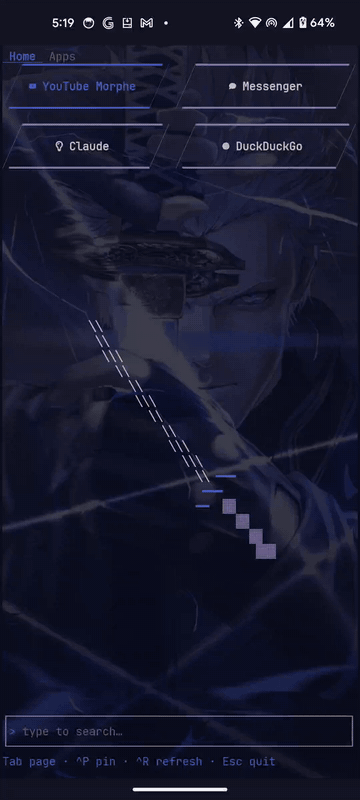

# termdeck

Touch-friendly app launcher TUI for Termux: pinned apps, recent list, fuzzy search, launch in ~50 ms via `termux-am`.
Inspired by [T-UI](https://github.com/fandreuz/TUI-ConsoleLauncher), the Linux CLI launcher for Android.



- **Home**: up to N rows of pinned apps over a spinning katana (or your own ASCII art).
- **Apps**: a second pin list plus recently launched apps, and a Settings button.
- **Search** from any page; results are the same rows as Recent.
- **Notes**: tap the pencil (or Ctrl+N) and the prompt appends a line to a markdown file. The Notes
  tab lists them newest first: tap one to edit it, tap its trash icon twice to delete it.
- Colors come from the terminal palette, so a [pywal](https://github.com/eylles/pywal16) scheme in
  `~/.termux/colors.properties` themes it (see [termux-config](https://github.com/Iodize13/termux-config)).
- Nerd Font icons for common apps; buttons are rectangles or parallelograms, outlined or filled.

## Use as the home screen

I run termdeck as my Android home launcher: [AnyHome](https://github.com/tytydraco/AnyHome) (`com.draco.anyhome`)
is set as the default launcher with Termux as its target, so pressing Home brings up Termux running termdeck.

## Install (on the phone)

```sh
pkg install aapt termux-am-socket tmux   # tmux only for the dev loop
mkdir -p ~/bin && cp termdeck ~/bin/     # binary built below
```

Grant Termux **Settings > Apps > Termux > Display over other apps**, otherwise launches fail with a hint in the status line.
Use a [Nerd Font](https://www.nerdfonts.com/) as `~/.termux/font.ttf` for icons, stars and slanted button edges.

## Build (on the laptop)

```sh
rustup target add aarch64-unknown-linux-musl
cargo install cargo-zigbuild   # plus `zig` on PATH
cargo zigbuild --release --target aarch64-unknown-linux-musl
# -> target/aarch64-unknown-linux-musl/release/termdeck (static)
```

## Dev loop

`scripts/dev.sh` builds, copies the binary to the phone and restarts it in tmux session `termdeck`.
Phone address comes from `TERMDECK_PHONE` (default `-p 8022 u0_a339@192.168.95.171`).

```sh
scripts/dev.sh
ssh -p 8022 u0_a339@192.168.95.171 tmux capture-pane -p -t termdeck
ssh -p 8022 u0_a339@192.168.95.171 tmux send-keys -t termdeck -l yt
```

## Controls

| Input | Action |
| --- | --- |
| type | search |
| Up/Down, Left/Right (empty prompt) | move selection |
| Enter | launch selection |
| Tab / Shift+Tab | next / previous page |
| swipe up on Home / down at top of Apps | switch page |
| Ctrl+P | pin/unpin selection on the current page |
| Ctrl+R | refresh app index |
| Ctrl+N or the pencil in the prompt | note mode: Enter appends the text to the notes file |
| Left/Right, Home/End (with text) | move the cursor; tapping the text places it too |
| Enter on the Notes tab | edit the selected note |
| Esc | leave note mode, clear query, back to Home, quit |
| Ctrl+C | quit |

Tap a button to launch, tap the star to pin, tap a tab to switch pages.

## Config

Settings (Apps page, top right) writes `~/.config/termdeck/config.json`:

```json
{
  "home_rows": 3,
  "pinned_shape": "parallelogram",
  "pinned_style": "outline",
  "list_shape": "parallelogram",
  "list_style": "filled",
  "icons": true,
  "notes_path": ""
}
```

Notes are appended as `- YYYY-MM-DD HH:MM text` lines. Edits rewrite only that line (other lines,
like headings added elsewhere, are kept) and are refused if the line changed since it was loaded.

By default (`"notes_path": ""`) notes go to `~/.local/share/termdeck/notes.md`, private to Termux.
To sync them to other devices, run `termux-setup-storage` once, set e.g.
`"notes_path": "~/storage/shared/Notes/mobile.md"`, and share that folder with Syncthing. Only the
phone writes this file, so syncing it never conflicts.

`~/.config/termdeck/art.txt`, if present, replaces the katana with static ASCII art.

State: `~/.cache/termdeck/index.json`, `~/.local/share/termdeck/state.json` (honours `XDG_*`).

## Known issues

- Hiding the on-screen keyboard and then bringing it back can freeze termdeck. Restart Termux to recover.
